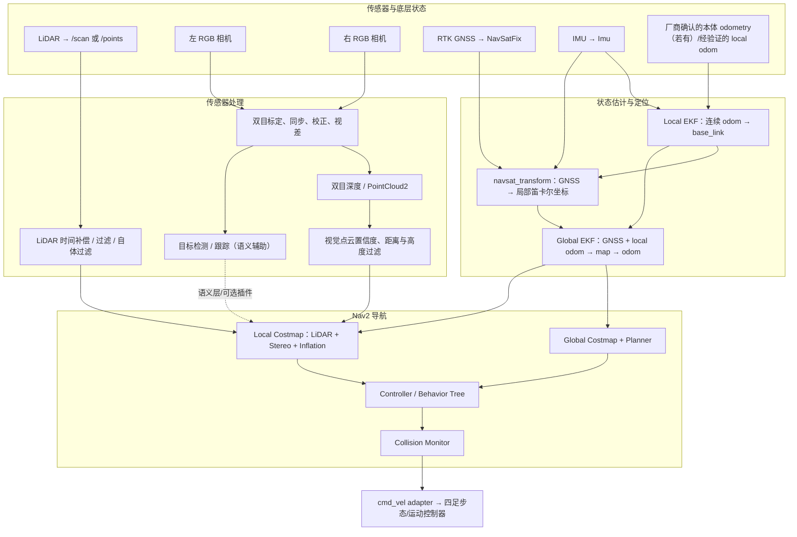

# RobDog Nav2 — 四足机器狗导航与实时避障

> 使用 **LiDAR + RTK GNSS + 两台普通 RGB 2D 相机（被动双目）**，基于 ROS 2 / Nav2 构建四足机器狗的定位、导航、动态障碍物检测和实时避障系统。

本仓库已完成首轮硬件技术预选：DEEP Robotics Lite3 Venture、Livox MID-360、两台 e-con Systems See3CAM_50CUG_CXXCC_BX_H01R1（Color，无镜头）、ArduSimple ZED-F9P RTK 和 Jetson AGX Orin。尚未采购或实物验证，具体接口、供电、安装和标定仍以根目录 TaskPlan.md 的准入清单为准。

## 项目目标

开发面向四足机器狗的完整导航闭环：

1. 获取 LiDAR、RTK、左右 RGB 相机、IMU 与机器狗底层里程计数据。
2. 形成连续、可信的本体状态估计与统一 TF 坐标树。
3. 室外使用 RTK 提供全局地理定位；本地运动估计保持连续，不因 GNSS 跳变而抖动。
4. 利用 LiDAR 和双目视觉深度识别静态、动态及部分低矮/高处障碍物。
5. 通过 Nav2 全局规划、局部控制、行为树和恢复行为执行路径导航。
6. 通过 Collision Monitor 做独立于 costmap/controller 的快速减速/停止逻辑。
7. 将 Nav2 的速度指令安全地转换为机器狗底层步态/运动控制接口。
8. 通过仿真、台架、封闭场地和受控户外测试逐层验证。

## 已确定的初始路线

- **主要导航框架：** ROS 2 Nav2。
- **主要几何避障传感器：** Livox MID-360 3D LiDAR，输出 PointCloud2。
- **全局定位：** ArduSimple ZED-F9P RTK GNSS；需结合 Lite3 IMU 和厂商确认的本体 odometry。当前新旧 Lite3 SDK 的状态接口不同，可信 legged odometry 尚待供应商确认；若缺失，将优先评估 MID-360 + Point-LIO 提供连续局部 odometry，单天线 GNSS 本身不能可靠提供静止时机身航向。
- **视觉：** 两台 See3CAM_50CUG_CXXCC_BX_H01R1（Color，无镜头） 普通 RGB 相机组成被动双目系统，提供视差/深度点云以及目标语义识别；它不是天然等同于工业 RGB-D 相机。
- **定位融合：** 以 `robot_localization` 双 EKF + `navsat_transform_node` 作为首选参考架构，具体状态变量、协方差和数据源须基于底层实际输出标定。
- **障碍物融合：** LiDAR 与双目点云保留独立观测源，分别做时间戳、TF、范围、高度、置信度和自体过滤，再接入 Nav2 costmap；不在未经验证的情况下简单拼接成一个点云。
- **局部避障：** Nav2 local costmap + controller + Collision Monitor；机器狗底层控制器必须提供限速、急停/停止、命令超时保护。
- **地形可通行性：** Nav2 2D costmap 不足以描述所有坡度、台阶、沟坎、悬崖和落足风险。此类能力需要地形分析/可通行性层及必要的自定义 costmap 插件或底层落足规划配合。

## 当前 ROS 2 软件基线

软件版本策略分两层：首轮复现云深处官方参考栈 **Ubuntu 22.04 + JetPack 6.1 + ROS 2 Humble**；同时在 AGX Orin 上验证 **JetPack 7.2.2 + Ubuntu 24.04 + ROS 2 Jazzy**，将 Jazzy 作为当前 Orin 长期目标。ROS 2 Lyrical 已于 2026 年 5 月发布、支持至 2031 年 5 月，但其 Tier 1 Ubuntu 平台是 26.04，而当前 JetPack 7.2.2 的 Orin 基线为 Ubuntu 24.04，因此暂不作为本项目部署基线。详见根目录 TaskPlan.md。

## 系统数据流（概念图）

## 传感器分工

| 设备 | 核心职责 | 不应承担的职责 |
|---|---|---|
| LiDAR | 稳定几何测距、局部占据/障碍物标记与清除 | 单独完成全部语义识别；单线 2D LiDAR 不能看见扫描平面以外所有障碍物 |
| RTK GNSS | 室外绝对位置、地理航点与全局漂移约束 | 近场避障；静止单天线 RTK 不提供可靠航向；非固定解不能当作厘米级真值 |
| 双目 RGB | 语义检测、视觉深度、补充 LiDAR 视场/高度盲区 | 在透明/反光/无纹理/弱光场景中保证深度；单独承担安全急停 |
| IMU + 厂商确认的本体 odometry | 连续姿态、速度与本体运动估计 | 当前 sdk_deploy 是否提供完整 legged odometry 仍待确认；未验证的足端滑移不能视作无误差里程计 |

## 关键架构约束

- **定位 TF：** `map → odom → base_link → {lidar_link, left_camera_optical_frame, right_camera_optical_frame, imu_link, gnss_link}`。每条 TF 只能有一个权威发布者。
- **平滑性：** local EKF 优先维持连续的 `odom → base_link`；GNSS 修正放在 global EKF 中形成 `map → odom`，避免 RTK 更新直接造成局部速度/姿态突跳。
- **相机：** 两相机必须刚性安装、视场重叠、标定准确并尽可能硬件同步；发布正确的 CameraInfo 和 optical frame。
- **四足机身运动：** 机身俯仰/横滚、步态周期、冲击和相机/LiDAR 扫描运动都必须纳入时间同步、运动补偿和 TF 设计。
- **导航运动模型：** 先确认机器狗是差速式、全向式还是具有受限横移/旋转能力。Nav2 controller 的 holonomic、速度/加速度约束必须与底层真实能力一致。
- **命令链路：** `Nav2 → velocity smoother → collision monitor → cmd_vel adapter → robot controller`。最终拓扑与 remap 在接口确认后锁定；底层必须有命令 watchdog 和硬件级停止手段。
- **失效策略：** RTK 降级、传感器超时、TF 缺失、深度无效、定位协方差超限、控制器离线时，必须触发限速、停车或导航降级，不能沿用过期数据继续盲行。
- **安全：** Nav2 Collision Monitor 是软件级 CPU 监测，不是安全认证设备。人机协作/公共环境的安全完整性必须另行评估硬件急停、独立安全扫描器和执行机构制动能力。

## 文档导航

- [系统架构与数据流](docs/architecture/system_architecture.md)
- [传感器接入与融合](docs/architecture/sensor_fusion.md)
- [Nav2 导航、Costmap 与实时避障](docs/navigation/nav2_navigation.md)
- [坐标系、定位与 TF 设计](docs/localization/frames_and_localization.md)
- [双目 RGB 深度与障碍物识别](docs/perception/stereo_obstacle_perception.md)
- [验证、安全与失效降级](docs/validation/safety_and_validation.md)
- [硬件/软件接口确认清单](docs/interfaces/hardware_interface_checklist.md)
- [硬件平台选型 ADR-0002](docs/decisions/ADR-0002-hardware-platform.md)
- [ROS 2 Workspace 与 package 规划](docs/implementation/ros2_workspace_and_packages.md)
- [导航与感知验收测试矩阵](docs/testing/acceptance_test_matrix.md)
- [实施任务计划 TaskPlan（唯一进度台账）](TaskPlan.md)
- [TaskPlan Part 1：架构与硬件设计](TaskPlan_Part-01_ArchitectureAndHardware.md)
- [TaskPlan Part 2：测试、风险与参考资料](TaskPlan_Part-02_TestingAndGovernance.md)
- [Lite3 本体 bridge 接口契约](docs/implementation/lite3_bridge_interface.md)
- [Lite3 厂商 SDK 集成路径评估](docs/implementation/lite3_vendor_sdk_integration_assessment.md)
- [传感器融合与 LIO 备用架构](docs/architecture/sensor_fusion.md)
- [ADR-0003：Lite3 ROS 集成路径](docs/decisions/ADR-0003-lite3-ros-integration.md)
- [本体 odometry 缺失时的 LIO/VIO 备用方案](docs/implementation/odometry_fallback_strategy.md)
- [ADR-0004：本体 odometry 备用方案](docs/decisions/ADR-0004-local-odometry-fallback.md)
- [Lite3 Venture 供应商技术确认矩阵](docs/interfaces/lite3_vendor_confirmation_matrix.md)
- [Lite3 跨发行版遥测网关协议提案](docs/implementation/lite3_gateway_protocol.md)
- [Lite3 厂商 SDK 集成路径评估](docs/implementation/lite3_vendor_sdk_integration_assessment.md)
- [ADR-0003：Lite3 ROS 集成路径](docs/decisions/ADR-0003-lite3-ros-integration.md)
- [多传感器时间同步与标定](docs/implementation/time_sync_and_calibration.md)
- [机载供电与载荷预算](docs/implementation/power_mass_budget.md)
- [双目光学、同步与 RTK 接入基线](docs/implementation/stereo_optics_and_rtk_baseline.md)
- [Lite3 公开 SDK 字段与安全审计](docs/implementation/lite3_public_sdk_field_audit.md)
- [MID-360 Livox 驱动锁定基线](docs/implementation/livox_mid360_driver_baseline.md)
- [Point-LIO Jazzy POC 来源与验收基线](docs/implementation/point_lio_jazzy_poc_baseline.md)
- [Point-LIO 固定源准备脚本](scripts/prepare_point_lio_intel_ros2.sh)
- [导航与避障验收指标框架](docs/testing/acceptance_metrics_and_scenarios.md)
- [TaskPlan 历史归档（2026-11-24）](docs/history/TaskPlan-History-2026-11-24.md)
- [初始 Lite3 bridge ROS 2 package](src/robodog_lite3_bridge/README.md)
- [决策记录 ADR-0001](docs/decisions/ADR-0001-sensor-roles-and-localization.md)
- [前序讨论归档](docs/discussion/2026-11-24-stereo-camera-discussion.md)
- [参考资料](docs/references.md)
- [源代码目录说明](src/README.md)
- [配置目录说明](config/README.md)
- [Launch 目录说明](launch/README.md)

## 当前阶段状态

**阶段 A：硬件基线与接口冻结** 正在进行。硬件已有技术预选，但尚未采购，尚未完成供应商确认、质量/电源预算、驱动编译、标定、融合和真实机器狗测试。根目录 [TaskPlan.md](TaskPlan.md) 是唯一进度台账。

## 重要外部参考

- [Nav2 Jazzy：Mapping and Localization](https://docs.nav2.org/jazzy/configuration_and_development/first_time_robot_setup_guide/sensors/mapping_localization.html)
- [Nav2 Jazzy：Collision Monitor](https://docs.nav2.org/jazzy/configuration_and_development/configuration_guide/collision_monitor/configuring-collision-monitor-node.html)
- [Nav2：GPS Navigation Tutorial](https://docs.nav2.org/tutorials/docs/navigation2_with_gps.html)
- [robot_localization：navsat_transform_node](https://github.com/cra-ros-pkg/robot_localization/blob/rolling-devel/doc/navsat_transform_node.rst)
- [Nav2：TF Setup](https://docs.nav2.org/setup_guides/transformation/setup_transforms.html)
- [ROS 2 Jazzy release](https://www.openrobotics.org/blog/2024/5/ros-jazzy-jalisco-released)
- [ROS 2 Lyrical Luth release](https://discourse.openrobotics.org/t/ros-2-lyrical-luth-released/55021)
- [NVIDIA JetPack 7.2.2](https://developer.nvidia.com/embedded/jetpack/downloads)
